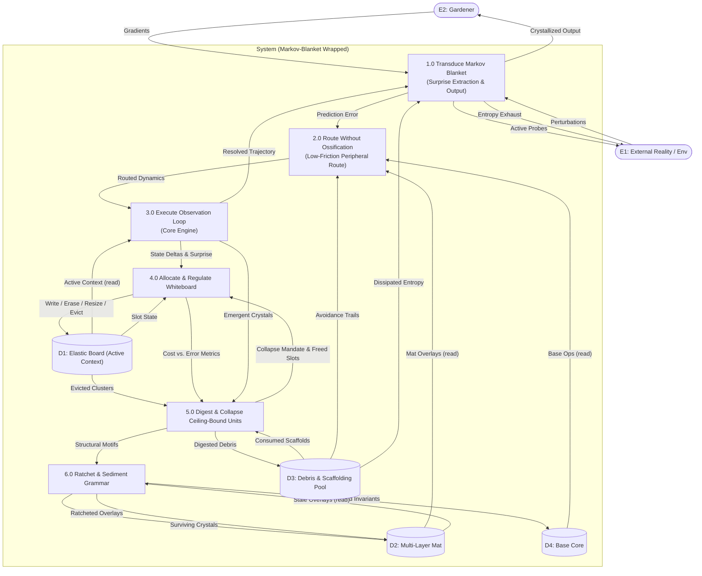

# v0.10 DFD

Level-0 data-flow diagram for the v0.10 architecture. Hand-drawn ASCII is
retired (see git history); every flow is now a single directed Mermaid edge
and is cross-checked against the flow ledger below. This artifact describes
a design, not a running system: "tested" would mean at least one executable
or simulation pass that consumes it.

## Flow ledger

| # | Source | Flow | Target |
|---|--------|------|--------|
| 1 | E2 Gardener | Gradients | 1.0 Transduce Markov Blanket |
| 2 | 1.0 Transduce Markov Blanket | Crystallized Output | E2 Gardener |
| 3 | E1 External Reality | Perturbations | 1.0 Transduce Markov Blanket |
| 4 | 1.0 Transduce Markov Blanket | Active Probes | E1 External Reality |
| 5 | 1.0 Transduce Markov Blanket | Entropy Exhaust | E1 External Reality |
| 6 | 1.0 Transduce Markov Blanket | Prediction Error | 2.0 Route Without Ossification |
| 7 | D4 Base Core | Base Ops (read) | 2.0 Route Without Ossification |
| 8 | D2 Multi-Layer Mat | Mat Overlays (read) | 2.0 Route Without Ossification |
| 9 | 2.0 Route Without Ossification | Routed Dynamics | 3.0 Execute Observation Loop |
| 10 | 3.0 Execute Observation Loop | Resolved Trajectory | 1.0 Transduce Markov Blanket |
| 11 | D1 Elastic Board | Active Context (read) | 3.0 Execute Observation Loop |
| 12 | 3.0 Execute Observation Loop | State Deltas & Surprise | 4.0 Allocate & Regulate Whiteboard |
| 13 | 4.0 Allocate & Regulate Whiteboard | Write / Erase / Resize / Evict | D1 Elastic Board |
| 14 | D1 Elastic Board | Slot State | 4.0 Allocate & Regulate Whiteboard |
| 15 | D1 Elastic Board | Evicted Clusters | 5.0 Digest & Collapse Ceiling-Bound Units |
| 16 | 4.0 Allocate & Regulate Whiteboard | Cost vs. Error Metrics | 5.0 Digest & Collapse Ceiling-Bound Units |
| 17 | 5.0 Digest & Collapse Ceiling-Bound Units | Collapse Mandate & Freed Slots | 4.0 Allocate & Regulate Whiteboard |
| 18 | 3.0 Execute Observation Loop | Emergent Crystals | 5.0 Digest & Collapse Ceiling-Bound Units |
| 19 | 5.0 Digest & Collapse Ceiling-Bound Units | Digested Debris | D3 Debris & Scaffolding Pool |
| 20 | D3 Debris & Scaffolding Pool | Consumed Scaffolds | 5.0 Digest & Collapse Ceiling-Bound Units |
| 21 | 5.0 Digest & Collapse Ceiling-Bound Units | Structural Motifs | 6.0 Ratchet & Sediment Grammar |
| 22 | 6.0 Ratchet & Sediment Grammar | Sedimented Invariants | D4 Base Core |
| 23 | 6.0 Ratchet & Sediment Grammar | Surviving Crystals | D2 Multi-Layer Mat |
| 24 | 6.0 Ratchet & Sediment Grammar | Ratcheted Overlays | D2 Multi-Layer Mat |
| 25 | D2 Multi-Layer Mat | Stale Overlays (read) | 6.0 Ratchet & Sediment Grammar |
| 26 | D3 Debris & Scaffolding Pool | Avoidance Trails | 2.0 Route Without Ossification |
| 27 | D3 Debris & Scaffolding Pool | Dissipated Entropy | 1.0 Transduce Markov Blanket |

## Disambiguation notes

Two wirings were unrecoverable from the original ASCII geometry and are now
explicit best-guess choices, flagged here for veto:

- **Structural Motifs** (#21): drawn as `5.0 -> 6.0`. The old diagram wired it
  from `D3` via a bottom-frame junction, which contradicted the digest/ratchet
  pipeline.
- **Emergent Crystals** (#18): drawn as `3.0 -> 5.0`, following the head positions
  above `5.0` in the old diagram. If instead crystals are a product of
  `5.0` laid into `D2` as new mat layers, retarget this edge and ledger row.
- **4.0** was retitled from "Reg. Whiteboard" to "Allocate & Regulate
  Whiteboard" so the process number carries a verb; its storage operations
  remain the `D1` boundary flows.
