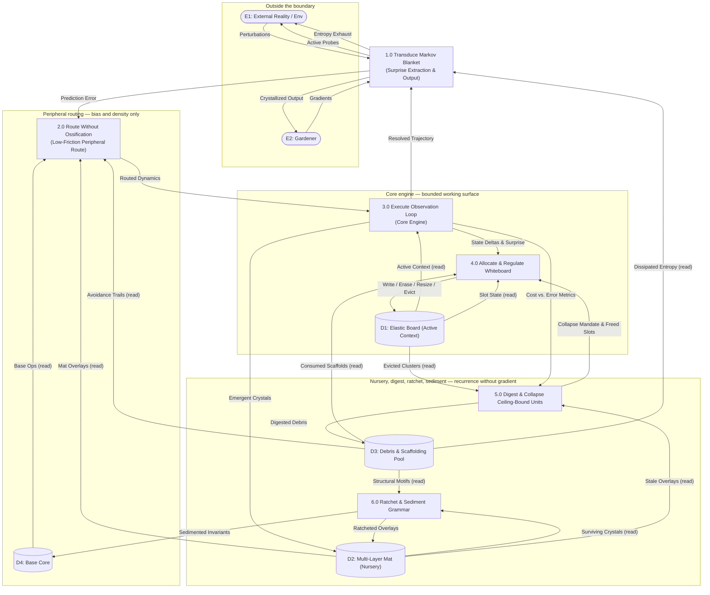

# v0.10 DFD

Level-0 data-flow diagram for the v0.10 architecture. Hand-drawn ASCII is
retired (see git history); every flow is now a single directed Mermaid edge
and is cross-checked against the flow ledger below. This artifact describes
a design, not a running system: "tested" would mean at least one executable
or simulation pass that consumes it.

**Round 10 spec correction (2026-11-20).** An independent audit compared
this ledger against the original ASCII geometry and found that seven edges
had been misread. The ASCII reading has been accepted by the user and is
now the spec; this document, `amateur/ledger.py`, and every diagram derived
from them are corrected together. See [Disambiguation notes](#disambiguation-notes)
for the audit record and the superseded readings.

## Flow ledger

| # | Source | Flow | Target |
|---|--------|------|--------|
| 1 | E2 Gardener | Gradients | 1.0 Transduce Markov Blanket |
| 2 | 1.0 Transduce Markov Blanket | Crystallized Output | E2 Gardener |
| 3 | E1 External Reality | Perturbations | 1.0 Transduce Markov Blanket |
| 4 | 1.0 Transduce Markov Blanket | Active Probes | E1 External Reality |
| 5 | 1.0 Transduce Markov Blanket | Entropy Exhaust | E1 External Reality |
| 6 | 1.0 Transduce Markov Blanket | Prediction Error | 2.0 Route Without Ossification |
| 7 | D4 Base Core | Base Ops (read) | 2.0 Route Without Ossification |
| 8 | D2 Multi-Layer Mat | Mat Overlays (read) | 2.0 Route Without Ossification |
| 9 | 2.0 Route Without Ossification | Routed Dynamics | 3.0 Execute Observation Loop |
| 10 | 3.0 Execute Observation Loop | Resolved Trajectory | 1.0 Transduce Markov Blanket |
| 11 | D1 Elastic Board | Active Context (read) | 3.0 Execute Observation Loop |
| 12 | 3.0 Execute Observation Loop | State Deltas & Surprise | 4.0 Allocate & Regulate Whiteboard |
| 13 | 4.0 Allocate & Regulate Whiteboard | Write / Erase / Resize / Evict | D1 Elastic Board |
| 14 | D1 Elastic Board | Slot State (read) | 4.0 Allocate & Regulate Whiteboard |
| 15 | D1 Elastic Board | Evicted Clusters (read) | 5.0 Digest & Collapse Ceiling-Bound Units |
| 16 | 3.0 Execute Observation Loop | Cost vs. Error Metrics | 5.0 Digest & Collapse Ceiling-Bound Units |
| 17 | 5.0 Digest & Collapse Ceiling-Bound Units | Collapse Mandate & Freed Slots | 4.0 Allocate & Regulate Whiteboard |
| 18 | 3.0 Execute Observation Loop | Emergent Crystals | D2 Multi-Layer Mat |
| 19 | 5.0 Digest & Collapse Ceiling-Bound Units | Digested Debris | D3 Debris & Scaffolding Pool |
| 20 | D3 Debris & Scaffolding Pool | Consumed Scaffolds (read) | 4.0 Allocate & Regulate Whiteboard |
| 21 | D3 Debris & Scaffolding Pool | Structural Motifs (read) | 6.0 Ratchet & Sediment Grammar |
| 22 | 6.0 Ratchet & Sediment Grammar | Sedimented Invariants | D4 Base Core |
| 23 | D2 Multi-Layer Mat | Surviving Crystals (read) | 6.0 Ratchet & Sediment Grammar |
| 24 | 6.0 Ratchet & Sediment Grammar | Ratcheted Overlays | D2 Multi-Layer Mat |
| 25 | D2 Multi-Layer Mat | Stale Overlays (read) | 5.0 Digest & Collapse Ceiling-Bound Units |
| 26 | D3 Debris & Scaffolding Pool | Avoidance Trails (read) | 2.0 Route Without Ossification |
| 27 | D3 Debris & Scaffolding Pool | Dissipated Entropy (read) | 1.0 Transduce Markov Blanket |

## Disambiguation notes

**Round 10 audit record (supersedes the prior resolutions below).** The
ledger shipped in rounds 8–9 was built from a transcription of the original
ASCII, not from the ASCII itself; the transcription misread seven edges on
the lower half of the drawing. An independent reviewer re-read the ASCII,
the user accepted that reading, and these seven edges are corrected:

| fid | Flow | Drifted (superseded) | Corrected (spec) |
|-----|------|----------------------|------------------|
| #16 | Cost vs. Error Metrics | 4.0 → 5.0 | **3.0 → 5.0** |
| #18 | Emergent Crystals | 3.0 → 5.0 | **3.0 → D2** |
| #20 | Consumed Scaffolds (read) | D3 → 5.0 | **D3 → 4.0** |
| #21 | Structural Motifs | 5.0 → 6.0 | **D3 → 6.0 (read)** |
| #23 | Surviving Crystals | 6.0 → D2 | **D2 → 6.0 (read)** |
| #25 | Stale Overlays (read) | D2 → 6.0 | **D2 → 5.0** |
| #27 | Dissipated Entropy | *deleted* | **D3 → 1.0 (read), restored** |

Consequences: the ledger has **27 flows**. **5.0 → 6.0 no longer exists**
(the ratchet mines D3, not the digester); **4.0 no longer outputs #16**; D2's
write set changes from `{23, 24}` to `{18, 24}` and **#23 becomes a read**;
D3 gains an exit (#27), closing the pool-never-drains hole.

**D2 is a nursery, not a ratchet-only store.** The corrected lifecycle: the
loop births candidate crystals into the mat (#18) → candidates live and
revalidate there → the ratchet reads the survivors (#23) → sediment to D4
(#22) and/or write-back as overlays (#24) → stale candidates go to
digestion (#25) → debris to D3 (#19) → the ratchet mines motifs from D3
(#21). **D4 remains the only ratchet-only store.**

Prior resolutions voided by this correction (they reasoned about the wrong
graph): the `{D2, D4}` ratchet-only INV-GEOMETRY reading; the INV-CENSUS
figures; the cycle-based INV-CYCLE-DELAY justification; the INV-EXHAUST
no-residue-edge reading; the D2 write whitelist and any payload-purity
theorem built on it; the crystal lexicon below. The re-specified wording is
tracked separately and is not yet adjudicated.

Retained from the prior document, unchanged by the correction:

- **4.0** is titled "Allocate & Regulate Whiteboard" so the process number
  carries a verb; its storage operations remain the `D1` boundary flows.
- **Slot State** (#14) carries the `(read)` marker: every store→process edge
  carries the marker, so the store-direction contract is machine-checkable.

Superseded readings, kept only so the correction is auditable:

- **Structural Motifs (#21)** was drawn `5.0 -> 6.0` on the argument that a
  `D3 -> 6.0` wiring "contradicted the digest/ratchet pipeline". The ASCII
  shows the bottom-frame junction as `D3 -> 6.0`; the pipeline argument was
  wrong and is withdrawn. The ratchet mines motifs from the debris pool.
- **Emergent Crystals (#18, now RESOLVED to `3.0 -> D2`)** was previously
  pinned to `3.0 -> 5.0` with a lexicon (`Emergent Crystal` = candidate into
  5.0; `Structural Motif` = rule out of 5.0; `Surviving Crystal` = vetted
  structure `6.0 -> D2`). Under the corrected graph the candidate enters
  **D2**, the ratchet **reads** survivors from D2 (#23), and 5.0 no longer
  receives or emits crystals. The lexicon is being rewritten and is not
  authoritative until adjudicated.
- **Dissipated Entropy (#27)** was deleted on the argument that degraded
  throughput "terminates at the boundary exhaust ... while only distinctions
  recur". The ASCII has the `D3 -> 1.0` edge; it is restored. Its payload
  type (flow / charge / scalar drain) and its interaction with identities
  A/B and the sink profile are under adjudication.
